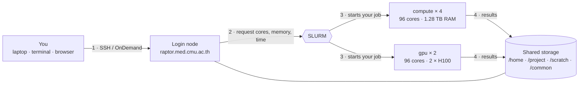
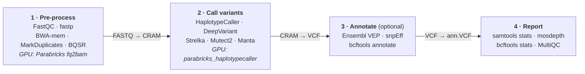
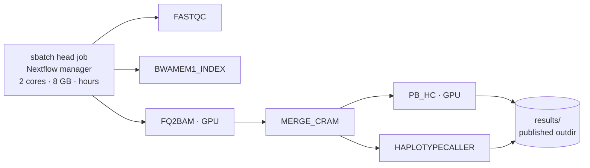

# From FASTQ to Variants with GPUs in MedCMU-HPC

**SLURM essentials, NVIDIA Clara Parabricks on H100 GPUs, and your first GPU-enabled nf-core/sarek run**

This workshop takes you from raw sequencing reads (FASTQ) to a variant list (VCF) on the **MedCMU-HPC (RAPTOR)** cluster. You will run bioinformatics tools through SLURM on CPU and GPU, then launch the **nf-core/sarek** pipeline with its GPU (Parabricks) path. Each part builds on the previous one, so follow along in order.

---

## Workshop Overview

### Workshop Resources

| Resource | Link |
|---|---|
| Workshop website | [cmu.to/hpc-workshop-docs](https://cmu.to/hpc-workshop-docs) |
| Presentation Slide | [Open the slide deck](pathname:///slides/fastq-to-variants-sarek-gpu.html) (use ← / → to navigate) |
| Cheat Sheet | [cmu.to/medcmu-hpc-cheatsheet](https://cmu.to/medcmu-hpc-cheatsheet) |
| Workshop Login Credential | [Get your temporary account](/docs/workshop-login-credential) |
| nf-core/sarek 3.10.0 | [nf-co.re/sarek/3.10.0](https://nf-co.re/sarek/3.10.0) |
| NVIDIA Clara Parabricks | [docs.nvidia.com/clara/parabricks](https://docs.nvidia.com/clara/parabricks/latest/) |

| | |
|---|---|
| **Audience** | Post-docs with a biology background who already know basic Linux and `module load` |
| **Duration** | 90 minutes — about half lecture, half hands-on |
| **Cluster** | RAPTOR — `raptor.med.cmu.ac.th` · `gpu` partition: 2 nodes × 2 NVIDIA H100 |
| **GPU software** | NVIDIA Clara Parabricks **4.7.1** (Apptainer image) |
| **Pipeline** | nf-core/sarek **3.10.0** with `--aligner parabricks` + `--tools parabricks_haplotypecaller` (needs Nextflow **≥ 25.10.4**) |

### Agenda

| Time | Block | What you will do |
|---|---|---|
| 0:00–0:05 | Welcome | Goals, logins, open this guide |
| 0:05–0:20 | Part 1 · HPC concepts | How a cluster works · RAPTOR resources · storage rules |
| 0:20–0:30 | Part 2 · Software | Modules · micromamba · Apptainer · Parabricks |
| 0:30–0:50 | Part 3 · SLURM | `srun` · `sbatch` · GPU jobs · **Hands-on 1** |
| 0:50–1:05 | Part 4 · nf-core/sarek | Pipeline · CPU vs GPU path · input, parameters, output |
| 1:05–1:28 | Part 5 · Hands-on 2 | FASTQ → VCF with sarek + Parabricks on H100 |
| 1:28–1:30 | Wrap-up | Recap · next steps · Q&A |

### Learning Goals

By the end of the workshop you can:

1. **Explain where your job runs** — login node vs compute nodes, partitions, and which storage tier to use for what.
2. **Pick the right software route** — environment modules, a micromamba env, or an Apptainer container, and why.
3. **Run tools on CPU and GPU** — FastQC with `srun`, then Parabricks on an H100 with `sbatch --gpus=1`, and check efficiency.
4. **Run sarek on GPUs** — samplesheet, parameters and a config that sends Parabricks steps to the GPU partition; find your VCFs.

:::info Conventions used in this guide
Lines starting with `$` are typed on the **login node**. Lines starting with `[compute]$` are typed **inside an interactive job**. Replace anything in `<angle brackets>` with your own value.
:::

:::warning Work in teams of 3–4 for the GPU steps
RAPTOR has **4 H100 GPUs in total**, shared by everyone. One person per team submits the GPU jobs ([3.2](#32-batch-job-on-a-gpu--parabricks-germline-calling) and [Part 5](#part-5--hands-on-2-nf-coresarek-on-gpus)); the others follow along and run the CPU steps on their own.
:::

---

## Part 0 — Log in and Set Up Your Workspace

Get a temporary account from the [Workshop Login Credential](/docs/workshop-login-credential) page if you do not have a MedCMU-HPC account yet, then connect:

```bash
$ ssh <username>@raptor.med.cmu.ac.th
```

Set a few variables that the rest of the guide uses:

```bash
$ export PROJ=demo                                          # <-- your project / SLURM account
$ export WS=/scratch/$PROJ/$USER/sarek-gpu                  # your workspace for today
$ export DEMO=/common/demo/sarek                            # read-only workshop data
$ export PB_SIF=/common/sif/clara-parabricks/4.7.1-1.sif    # Parabricks image
$ export APPTAINER_BIND=/common,/scratch,/project           # make shared storage visible inside containers
$ mkdir -p $WS/logs && cd $WS
```

Check your resources and the workshop data:

```bash
$ myquota          # storage left in /home, /project, /scratch
$ sbalance         # compute hours (SHr) left on your project
$ sinfo -p gpu     # are the GPU nodes idle, mix or alloc?
$ ls $DEMO         # fastq/  ref/  testdata/  sif-cache/
```

:::tip Why /scratch?
`/scratch` is the fast 40 TB flash tier — ideal for pipeline intermediates (Parabricks writes a lot of temporary data). It is **not backed up** and files are **removed 30 days after creation**, so copy final results to `/project` ([step 5.9](#59--resume-clean-up-and-moving-results)).
:::

---

## Part 1 — HPC Concepts & the RAPTOR Cluster

### 1.1 A Cluster Works Like a Shared Core Lab

| In the core lab | On the cluster | What it means for you |
|---|---|---|
| Reception desk | Login node | Where you arrive, edit files and submit work — **never run analyses here** |
| Benches & instruments | Compute nodes | CPU cores, RAM and GPUs that do the real work |
| Instrument booking system | SLURM scheduler | Queues requests fairly and assigns free resources |
| Freezers & cold room | Storage | `/home`, `/project` (backed up), `/scratch` (fast, temporary) |
| Shared reagent shelf | `/apps` · `/common` | Installed software, reference data, container images |

You never walk into the instrument room unannounced — you **book** it. On HPC, that booking is a **SLURM job**.

### 1.2 Anatomy of the RAPTOR Cluster



Every node is a full computer with its own cores, RAM and local disk, connected to **shared storage**. The same files are visible from the login node and all compute nodes, so you can prepare files on the login node and process them on compute nodes.

### 1.3 RAPTOR at a Glance

| | **compute** · 4 nodes | **gpu** · 2 nodes |
|---|---|---|
| Per node | 96 cores, 1,280 GB RAM | 96 cores, 384 GB RAM, 2 × NVIDIA H100 |
| Good for | Alignment, variant calling, assembly, Nextflow pipelines | AI/ML, Parabricks, DeepVariant on GPU, AlphaFold |

In total: **576 CPU cores**, **4 × H100 GPUs**, and **0.5 PB** of shared storage.

### 1.4 Partitions: Pick the Right Queue

| Partition | Cores / node | RAM / node | GPU | Max time | Use for |
|---|---|---|---|---|---|
| **short** | 1 | 8 GB | — | 8 h | Tests, interactive work, small jobs |
| **compute** | 94 | 1,280 GB | — | none | Real analyses & pipelines |
| **gpu** | 94 | 384 GB | 2 × H100 | none | GPU-accelerated tools |

:::warning The partition alone gives you no GPU
`gpu` has only **4 H100s for everyone**. Ask for one explicitly with `--gpus=1` (or `-G 1`). And **never** run alignment or variant calling on the login node — use `srun` or `sbatch`.
:::

### 1.5 Where Should Your Files Live?

| Path | Size | Notes | Put here |
|---|---|---|---|
| `/home/<user>` | 100 GB · personal | Removed after 1 year inactive | Scripts, configs, envs |
| `/project/<proj>` | 1 TB · shared by project | Weekly backup | Raw data & final results |
| `/scratch/<proj>` | 1 TB · fast flash | **No backup · deleted after 30 days** | Pipeline `work/` dirs |
| `/common` | Read-only, shared | — | Reference data, demo data, container images (`/common/sif`) |

```bash
$ myquota     # storage used / left per path
$ sbalance    # compute hours (SHr) left per project
# SHr = cores × hours ÷ 94      e.g. 8 cores × 3 h ≈ 0.26 SHr
```

:::danger Data Policy
**No identifiable patient data** (HN, names, birth dates) on the HPC — de-identify or code your samples first.
:::

---

## Part 2 — Getting Your Software

There are three ways to get a tool on RAPTOR:

| Route | What it is | Example | Use when |
|---|---|---|---|
| **Environment modules** | Pre-installed by HPC Support in `/apps` | `ml fastqc/0.12.1` | The tool appears in `ml av`. Fastest, zero setup. |
| **Micromamba** | Your own conda environments from conda-forge & bioconda | `micromamba create -n qc fastp` | A tool or Python/R package is missing. |
| **Apptainer** | Container images (`.sif`): the tool plus its whole OS stack, frozen | `apptainer exec fastqc.sif fastqc` | Software is complex, needs a GPU, or must be exactly reproducible. |

:::tip Link to sarek
nf-core pipelines run every step in its own container — you only add `-profile apptainer`.
:::

### 2.1 Environment Modules — Fastest Route

```bash
$ ml av                          # everything installed under /apps
$ ml spider samtools             # search by keyword
$ ml fastqc/0.12.1 samtools/1.21 # load pinned versions
$ ml                             # list loaded
$ ml -samtools                   # unload one
$ ml purge                       # unload all
```

- **Pin versions** — write `fastqc/0.12.1`, not `fastqc`, in scripts; the default version can change.
- **Start clean in jobs** — begin batch scripts with `module purge`, then load exactly what you need.

See also: [Environment Modules](/docs/Documentation/environment-modules).

### 2.2 Micromamba — Your Own Environments

First-time setup only (skip if done before):

```bash
$ module load mamba/1.5.8
$ micromamba shell init -s bash -r ~/micromamba
$ source ~/.bashrc
$ micromamba config append envs_dirs /apps/mamba/1.5.8/micromamba/envs
$ micromamba config append pkgs_dirs ~/micromamba/pkgs
```

Create and test an environment:

```bash
$ micromamba env list                                   # shared + yours
$ micromamba create -n qc -c conda-forge -c bioconda fastp -y
$ micromamba activate qc && fastp --version && micromamba deactivate
```

:::tip
Shared environments already exist under `/apps/mamba/1.5.8/micromamba/envs` — check there before building your own. Inside an `sbatch` script, add `source ~/.bashrc` then `micromamba activate qc` in the script body.
:::

### 2.3 Apptainer — How Parabricks Is Delivered

**NVIDIA Clara Parabricks** provides GPU re-implementations of the standard germline and somatic tools, built to reproduce GATK best-practice results, shipped as one container image:

- **`fq2bam`** — BWA-mem + sort + mark duplicates + BQSR report in **one GPU step** instead of four CPU steps.
- **`haplotypecaller`** — GPU GATK HaplotypeCaller. Also `deepvariant`, `mutectcaller` and more in the same image.

HPC Support has already pulled it as a `.sif` file:

```bash
$ module load apptainer
$ ls /common/sif/clara-parabricks/          # available Parabricks versions
$ apptainer exec $PB_SIF pbrun version      # works without a GPU — just prints the version
$ apptainer exec $PB_SIF pbrun fq2bam --help | head -n 30
```

Two Apptainer flags matter on RAPTOR:

- **`--nv`** passes the NVIDIA GPU driver into the container — add it whenever you actually *use* a GPU.
- **`-B /common,/scratch,/project`** (**bind**) makes those directories visible inside the container. By default Apptainer only mounts your `$HOME`, the current directory and `/tmp`, so without a bind you get errors like `Input file /common/demo/sarek/ref/genome.fasta not found`. The `APPTAINER_BIND` variable from Part 0 does the same for every command.

```bash
$ apptainer exec -B /common $PB_SIF ls /common/demo/sarek/ref   # explicit bind: you see the reference files
```

In Nextflow, the `gpu` profile adds `--nv`, and `autoMounts` + `runOptions` in `raptor.config` handle the binds ([step 5.4](#54-raptor-config--send-gpu-steps-to-the-gpu-partition)). See also: [Apptainer](/docs/Documentation/apptainer).

:::note Where Parabricks pays off
Real 30× genomes and exomes — CPU-hours become minutes. On today's tiny test data, GPU start-up dominates, so don't expect a big speed-up.
:::

### ✅ Checkpoint 1 — Which route would you choose?

1. You need `bcftools` today, and it is listed in `ml av`.
2. You need a niche Python tool from bioconda that is not installed.
3. You want NVIDIA's GPU version of BWA-mem + GATK.

<details>
<summary>Show answers</summary>

1. **Module** → `ml bcftools/1.21`
2. **Micromamba** environment
3. **Apptainer** → the Parabricks image: `apptainer exec --nv -B /common,/scratch,/project $PB_SIF pbrun …`

</details>

---

## Part 3 — SLURM on CPU and GPU (Hands-on 1)

**Golden rule:** the login node is the reception desk, not the lab bench. Everything heavy goes through SLURM.

### The Life of a SLURM Job


| | `srun` — interactive | `sbatch` — batch |
|---|---|---|
| How | You wait at the terminal and type commands on the compute node | You submit a script and walk away; output goes to log files |
| Good for | Exploring data, testing a command, debugging | Anything longer than a few minutes, pipelines, many samples |

See also: [Using SLURM](/docs/Documentation/use-slurm).

### 3.1 Interactive Jobs with `srun`

**CPU:** look at the data and run FastQC on the `short` partition:

```bash
$ srun -p short -A $PROJ -t 0:30:00 -c 1 --mem=4G --pty bash
[compute]$ hostname
[compute]$ zcat $DEMO/fastq/test_1.fastq.gz | head -n 8
[compute]$ echo $(( $(zcat $DEMO/fastq/test_1.fastq.gz | wc -l) / 4 ))   # number of reads
[compute]$ ml fastqc/0.12.1
[compute]$ mkdir -p qc && fastqc -o qc $DEMO/fastq/test_1.fastq.gz $DEMO/fastq/test_2.fastq.gz
[compute]$ exit
```

| Flag | Meaning |
|---|---|
| `-p` | partition |
| `-A` | account (project) |
| `-t` | time limit |
| `-c` | cores |
| `--mem` | memory |
| `--pty` | terminal |

:::caution Forgot to `exit`?
Your session keeps holding cores until the time limit — and keeps spending SHr.
:::

**GPU:** a quick peek at an H100 (one person per team, please):

```bash
$ srun -p gpu -A $PROJ -G 1 -c 1 --mem=2G -t 0:02:00 nvidia-smi
```

You should see **one** H100 (80 GB) — SLURM only exposes the GPU(s) you asked for (`-G 1` = `--gpus=1`).

:::info Asking SLURM for a GPU — all three, every time
1. **Right partition** — `-p gpu`
2. **Explicit GPU count** — `--gpus=1` (or `-G 1`). Without it you get CPUs on a GPU node, but no GPU.
3. **GPU + data into the container** — `apptainer exec --nv -B /common,/scratch,/project …` (Nextflow: `-profile apptainer,gpu`)
:::

### 3.2 Batch Job on a GPU — Parabricks Germline Calling

Parabricks `fq2bam` does **BWA-mem alignment + sorting + duplicate marking + BQSR report** in one GPU step; `haplotypecaller` is the GPU version of GATK HaplotypeCaller.

Create `02_parabricks.sbatch`:

```bash title="02_parabricks.sbatch"
#!/bin/bash
#SBATCH --job-name=pb_germline
#SBATCH --account=demo              # <-- your project
#SBATCH --partition=gpu
#SBATCH --gpus=1                    # ONE H100
#SBATCH --cpus-per-task=16
#SBATCH --mem=64G
#SBATCH --time=00:30:00
#SBATCH --output=logs/%x_%j.out
#SBATCH --error=logs/%x_%j.err

set -euo pipefail
module purge
module load apptainer

DEMO=/common/demo/sarek
PB_SIF=/common/sif/clara-parabricks/4.7.1-1.sif
REF=$DEMO/ref/genome.fasta                          # BWA index files sit next to it
KNOWN=$DEMO/ref/mills_and_1000G.indels.vcf.gz       # known sites for BQSR
mkdir -p pb/tmp

# Bind shared storage into the container (Apptainer only mounts $HOME, $PWD and /tmp by default)
BIND="-B /common,/scratch,/project"
PB="apptainer exec --nv $BIND $PB_SIF pbrun"

nvidia-smi --query-gpu=name,memory.total --format=csv   # which GPU did we get?

# 1) FASTQ -> duplicate-marked BAM + BQSR report  (GPU)
$PB fq2bam \
    --ref $REF \
    --in-fq $DEMO/fastq/test_1.fastq.gz $DEMO/fastq/test_2.fastq.gz \
            "@RG\tID:S01_L001\tLB:S01\tPL:ILLUMINA\tSM:S01\tPU:S01_L001" \
    --knownSites $KNOWN \
    --out-recal-file pb/S01.recal.txt \
    --out-bam pb/S01.bam \
    --bwa-cpu-thread-pool ${SLURM_CPUS_PER_TASK} \
    --tmp-dir $PWD/pb/tmp

# 2) BAM -> VCF, applying the BQSR report on the fly  (GPU)
$PB haplotypecaller \
    --ref $REF \
    --in-bam pb/S01.bam \
    --in-recal-file pb/S01.recal.txt \
    --out-variants pb/S01.pb_haplotypecaller.vcf

echo "Done on $(hostname) at $(date)"
```

Submit and monitor:

```bash
$ sbatch 02_parabricks.sbatch                  # -> Submitted batch job 12345
$ squeue --me                                  # PD (Resources) = waiting for a free GPU
$ tail -f logs/pb_germline_*.out               # Parabricks prints progress per stage
$ srun --jobid=<JOBID> --overlap nvidia-smi    # peek at the GPU *while* your job runs
$ seff <JOBID>                                 # after it finishes
$ ls -lh pb/
$ grep -vc '^#' pb/S01.pb_haplotypecaller.vcf  # number of variant records
```

:::note Honest expectation
On this tiny test dataset the GPU job is *not* dramatically faster than CPU — loading the container and the reference onto the GPU dominates. The speed-up appears with real data: a 30× whole genome is where Parabricks turns many CPU-hours into minutes. Always measure on one real sample before planning a cohort.
:::

### 3.3 Keeping an Eye on Your Jobs

| Command | What it tells you |
|---|---|
| `squeue --me` | Your pending (PD) and running (R) jobs |
| `tail -f logs/<job>.out` | Follow a job's output live |
| `sacct -j <JOBID>` | State, run time and memory of finished jobs |
| `seff <JOBID>` | CPU & memory efficiency — did you over-ask? |
| `srun --jobid=<ID> --overlap nvidia-smi` | GPU use of a running job |
| `scancel <JOBID>` | Cancel a job |
| `sinfo` | Node states: idle · mix · alloc · drain |

Job states: **PD** pending (`PD (Resources)` = waiting for a free GPU) · **R** running · **CD** completed · **F** failed · **TO** timeout · **OOM** out of memory.

### Three Habits of Efficient HPC Users

1. **Threads = cores requested** — pass `${SLURM_CPUS_PER_TASK}` to `-t` / `-@` / `--threads`. More threads than cores just slows everyone down.
2. **Measure, then right-size** — run one sample, read `seff`, then set memory ≈ peak × 1.2 for the rest.
3. **GPUs are scarce** — ask for one GPU, keep jobs short, and never leave an interactive GPU session idle.

Pipelines like sarek apply these habits for you — each step asks for its own cores, memory and time.

### ✅ Checkpoint 2 (optional) — CPU vs GPU

Run the classic CPU route on `short` and compare both jobs:

```bash title="01_bwa_cpu.sbatch"
#!/bin/bash
#SBATCH --job-name=bwa_cpu
#SBATCH --account=demo
#SBATCH --partition=short
#SBATCH --cpus-per-task=1
#SBATCH --mem=4G
#SBATCH --time=00:30:00
#SBATCH --output=logs/%x_%j.out
set -euo pipefail
module purge; module load bwa/0.7.18 samtools/1.21
DEMO=/common/demo/sarek; mkdir -p cpu
bwa mem -t ${SLURM_CPUS_PER_TASK} -R "@RG\tID:S01_L001\tSM:S01\tPL:ILLUMINA" \
    $DEMO/ref/genome.fasta $DEMO/fastq/test_1.fastq.gz $DEMO/fastq/test_2.fastq.gz \
  | samtools sort -o cpu/S01.sorted.bam -
samtools index cpu/S01.sorted.bam
```

```bash
$ sbatch 01_bwa_cpu.sbatch
$ sacct -j <ID1>,<ID2> --format=JobID,JobName,Partition,Elapsed,AllocCPUS,MaxRSS
```

On the tiny test data the CPU job may even finish first — GPU start-up overhead dominates. On a 30× WGS the picture reverses.

---

## Part 4 — nf-core/sarek: Concepts

### 4.1 nf-core/sarek in One Section

A community pipeline that turns **WGS, WES or panel FASTQ** into **germline or somatic variants** — pre-processing, variant calling and annotation, following GATK best practices.

- **Any design** — germline single samples, cohorts, tumour-only and tumour/normal pairs (with relapses).
- **Built on Nextflow** — runs the same on a laptop, RAPTOR or the cloud; resumes after failure.
- **One container per step** — no installing GATK yourself; every tool version is pinned and reproducible.
- **GPU-ready** — 3.10.0 adds Parabricks for alignment and HaplotypeCaller (experimental). Needs Nextflow ≥ 25.10.4.

### 4.2 From FASTQ to Answers: the Four Stages



**Nothing is called by default** — you choose callers and annotators with `--tools`. You can also start mid-way with `--step`.

### 4.3 Same Pipeline, Two Engines: CPU vs GPU


The GPU path is enabled with `--aligner parabricks` + `--tools parabricks_haplotypecaller`.

:::caution Experimental in sarek 3.10.0
Both Parabricks options are not yet at feature parity with the CPU path: **no UMI support**, **no joint germline calling with the GPU caller**, **no conda**. You can mix freely with CPU callers (strelka, manta…).
:::

### 4.4 Six Ideas Behind the Pipeline

| Concept | Meaning |
|---|---|
| **Read group** | Tags each read with sample + lane, so lanes can be merged and biases tracked. |
| **Duplicates** | PCR or optical copies of one DNA fragment; flagged so they don't fake extra evidence. |
| **BQSR** | Recalibrates the sequencer's base qualities using known variant sites (dbSNP, Mills). |
| **CRAM** | Compressed BAM that stores differences to the reference — about half the size; **keep the FASTA!** |
| **VCF / gVCF** | Variant list per site. gVCF also records non-variant blocks — needed for joint cohort calling. |
| **Germline vs somatic** | Inherited variants (status 0) vs tumour-acquired variants found by comparing tumour to normal. |

### 4.5 Which Caller for Which Question?

| Variant type | Germline (normal) | Tumour-only | Tumour / normal |
|---|---|---|---|
| SNVs & small indels | parabricks_haplotypecaller · haplotypecaller · deepvariant · strelka · freebayes | mutect2 · freebayes · lofreq | mutect2 · strelka · muse · freebayes |
| Structural variants | manta · tiddit | manta · tiddit | manta · tiddit |
| Copy number | cnvkit | cnvkit · controlfreec | ascat · cnvkit · controlfreec |
| Microsatellite instability | — | msisensor2 | msisensorpro |

- **Rare-disease germline:** `haplotypecaller` and/or `deepvariant` + `manta`, annotated with `vep`.
- **Cancer pair:** `mutect2` + `strelka` + `manta`, plus `ascat` or `cnvkit` for copy number.

### 4.6 How Nextflow Uses SLURM for You



The head job submits **one SLURM job per task**; GPU steps go to the `gpu` partition. Each task runs in `work/ab/12cd…/` and is cached for `-resume`. You give the pipeline three files:

| File | Answers | Contents |
|---|---|---|
| `samplesheet.csv` | **What data** | Patients, samples, FASTQ paths |
| `params.yaml` | **What science** | Genome, tools, outdir, step |
| `raptor.config` | **How & where** | SLURM, account, GPU queue, `--gpus=1` |

### 4.7 The Parameters That Matter

| Parameter | Example | Meaning |
|---|---|---|
| `--input` | `samplesheet.csv` | Your samples |
| `--outdir` | `results/` | Where results are published |
| `--genome` | `GATK.GRCh38` | Reference bundle (FASTA, dbSNP, known indels) |
| `--tools` | `parabricks_haplotypecaller` | Callers & annotators (none by default) |
| `--aligner` | `parabricks` | GPU fq2bam instead of BWA → BQSR |
| `--save_mapped` | `true` | Publish the aligned CRAM |
| `-profile` | `apptainer,gpu` | Containers + `--nv` for GPU steps |
| `-resume` | | Re-use cached, finished steps |

:::tip Double dash vs single dash
**Double dash** = pipeline parameter (put it in `params.yaml`) · **single dash** = Nextflow option. Don't put pipeline parameters in `-c` config files.
:::

---

## Part 5 — Hands-on 2: nf-core/sarek on GPUs

One germline test sample from human chr22 · Parabricks `fq2bam` + HaplotypeCaller on H100 · CPU caller for comparison.

| Step | What you do | Time |
|---|---|---|
| [5.2](#52-load-nextflow) | Load Nextflow — `module load nextflow apptainer`, check ≥ 25.10.4 | 2 min |
| [5.3](#53-samplesheet-input) | Samplesheet — one row: P01, S01, L001, two FASTQ paths | 3 min |
| [5.4](#54-raptor-config--send-gpu-steps-to-the-gpu-partition) | `raptor.config` — slurm · account · `PARABRICKS_*` → gpu, `--gpus=1` | 3 min |
| [5.5](#55-parameters-science) | `params.yaml` — aligner parabricks · tools · save_mapped | 3 min |
| [5.6](#56-launch-the-head-job) | Launch — `sbatch run_sarek.sbatch` (the head job) | 2 min |
| [5.7](#57-watch-it-run)–[5.8](#58-explore-the-outputs) | Watch & explore — nvidia-smi · MultiQC · GPU vs CPU VCF | 10 min |

Containers are pre-cached in `/common/demo/sarek/sif-cache`, so the run starts quickly. **One run per team** (4 GPUs).

### 5.1 What We Will Run

```
                  ┌──────────── GPU (gpu partition, 1 × H100) ────────────┐
FASTQ ─► FastQC ─►│ Parabricks fq2bam: BWA-mem + sort + MarkDuplicates     │─► CRAM
                  │                    + BQSR                              │
                  └────────────────────────────────────────────────────────┘
CRAM ─► Parabricks HaplotypeCaller (GPU)  ─► VCF
     └► GATK HaplotypeCaller (CPU)        ─► VCF      (CPU-vs-GPU comparison)
                                                   ─► MultiQC
```

- **Data:** the nf-core test sample (paired-end reads from a small region of human chr22).
- **Reference:** `testdata.nf-core.sarek`, mirrored on RAPTOR under `$DEMO/testdata`.
- **Switches:** `--aligner parabricks`, `--tools parabricks_haplotypecaller,haplotypecaller`, `-profile apptainer,gpu`.

### 5.2 Load Nextflow

```bash
$ cd $WS
$ module load nextflow apptainer
$ nextflow -v                                        # must be >= 25.10.4
$ export NXF_APPTAINER_CACHEDIR=$DEMO/sif-cache      # pre-pulled containers (Parabricks is several GB!)
$ export NXF_OPTS='-Xms1g -Xmx4g'
```

### 5.3 Samplesheet (Input)

```bash
$ cat > samplesheet.csv << EOF
patient,sex,status,sample,lane,fastq_1,fastq_2
P01,XX,0,S01,L001,$DEMO/fastq/test_1.fastq.gz,$DEMO/fastq/test_2.fastq.gz
EOF
```

| Column | Meaning | Our value |
|---|---|---|
| `patient` | Individual ID — groups tumour/normal samples of one person | `P01` |
| `sex` | `XX`, `XY` or `NA` | `XX` |
| `status` | `0` = normal/germline, `1` = tumour | `0` |
| `sample` | Sample ID — lanes of the same sample are merged | `S01` |
| `lane` | Lane/run ID, unique within a sample | `L001` |
| `fastq_1`, `fastq_2` | **Absolute** paths to R1/R2 — the most common source of errors | `$DEMO/fastq/...` |

A real study with two lanes and a matched tumour looks like this:

```csv
patient,sex,status,sample,lane,fastq_1,fastq_2
P01,XX,0,S01,L001,/path/S01_L001_R1.fastq.gz,/path/S01_L001_R2.fastq.gz
P01,XX,0,S01,L002,/path/S01_L002_R1.fastq.gz,/path/S01_L002_R2.fastq.gz
P01,XX,1,T01,L001,/path/T01_L001_R1.fastq.gz,/path/T01_L001_R2.fastq.gz
```

### 5.4 RAPTOR Config — Send GPU Steps to the GPU Partition

This is the key GPU-specific file. Sarek labels its Parabricks steps, but on a SLURM cluster **it does not request a GPU for `fq2bam` by itself** — we do it here.

```bash
$ cat > raptor.config << 'EOF'
// RAPTOR / MedCMU-HPC settings for nf-core/sarek with Parabricks
process {
    executor       = 'slurm'
    queue          = 'compute'
    clusterOptions = '--account=demo'                    // <-- your project
    resourceLimits = [ cpus: 16, memory: 96.GB, time: 4.h ]

    // GPU steps -> gpu partition, exactly one H100 each
    withName: 'PARABRICKS_FQ2BAM|PARABRICKS_HAPLOTYPECALLER' {
        queue          = 'gpu'
        clusterOptions = '--account=demo --gpus=1'       // <-- your project
        cpus           = 16
        memory         = 64.GB
        time           = 1.h
    }
}
executor {
    queueSize       = 20
    submitRateLimit = '10 sec'
}
apptainer {
    enabled    = true
    autoMounts = true                                 // binds the paths of staged input files
    runOptions = '--nv -B /common,/scratch,/project'  // GPU driver + shared storage for every task
}
EOF
```

:::info Profile and config — you need both
- The `gpu` **profile** (in `-profile apptainer,gpu`) adds `--nv` to Apptainer so containers can see the GPU.
- The **config** above makes SLURM actually allocate one.

`runOptions` here replaces the one set by the `gpu` profile, so it repeats `--nv`. On CPU-only nodes `--nv` only prints a harmless warning.
:::

### 5.5 Parameters (Science)

```bash
$ cat > params.yaml << EOF
input:          "$WS/samplesheet.csv"
outdir:         "$WS/results"
genome:         "testdata.nf-core.sarek"
igenomes_base:  "$DEMO/testdata"
aligner:        "parabricks"
tools:          "parabricks_haplotypecaller,haplotypecaller"
save_mapped:    true
split_fastq:    0
EOF
```

| Parameter | What it controls | Note |
|---|---|---|
| `aligner: parabricks` | Replaces BWA-mem → MarkDuplicates → BQSR with one GPU `fq2bam` step | Experimental |
| `tools: parabricks_haplotypecaller` | GPU germline SNV/indel calling, one VCF per sample | Germline only |
| `tools: haplotypecaller` | Classic CPU GATK caller — added for comparison | Optional |
| `save_mapped: true` | Publishes the Parabricks CRAM (otherwise it stays in `work/`) | Needed for IGV |
| `genome` / `igenomes_base` | Reference bundle and where it lives | `GATK.GRCh38` for real data |

### 5.6 Launch the Head Job

The head job itself needs **no GPU**; it only submits jobs. Create `run_sarek.sbatch`:

```bash title="run_sarek.sbatch"
#!/bin/bash
#SBATCH --job-name=sarek_head
#SBATCH --account=demo              # <-- your project
#SBATCH --partition=compute
#SBATCH --time=04:00:00
#SBATCH --cpus-per-task=2
#SBATCH --mem=8G
#SBATCH --output=logs/%x_%j.out
#SBATCH --error=logs/%x_%j.err

module purge
module load nextflow apptainer
export NXF_APPTAINER_CACHEDIR=/common/demo/sarek/sif-cache
export NXF_OPTS='-Xms1g -Xmx4g'

nextflow run nf-core/sarek -r 3.10.0 \
    -profile apptainer,gpu \
    -c raptor.config \
    -params-file params.yaml \
    -resume
```

| Option | Why |
|---|---|
| `-r 3.10.0` | Pin the pipeline version |
| `-profile apptainer,gpu` | Containers; `--nv` for GPU steps |
| `-c raptor.config` | GPU queue + binds (`runOptions`) |
| `-resume` | Safe to re-submit any time |

```bash
$ sbatch run_sarek.sbatch
$ squeue --me      # sarek_head on compute; soon nf-..._PARABRICKS_FQ2BAM on gpu
```

:::tip Offline copy
If HPC Support staged an offline copy of the pipeline, replace `nf-core/sarek -r 3.10.0` with its path (e.g. `/common/demo/sarek/pipeline/3_10_0`).
:::

### 5.7 Watch It Run

```bash
$ tail -f logs/sarek_head_*.out                      # progress per process
$ squeue --me -o "%.10i %.9P %.45j %.2t %.10M"       # partition column shows gpu vs compute
$ srun --jobid=<FQ2BAM_JOBID> --overlap nvidia-smi   # see Parabricks using the H100
$ grep -i error .nextflow.log | tail
```

If a step fails, Nextflow prints its `work/xx/yyyy…` folder: read `.command.err` and `.command.sh` there.

### 5.8 Explore the Outputs

```bash
$ cd $WS/results && ls
$ ls preprocessing/parabricks/S01/                     # S01.cram + .crai (because save_mapped)
$ ls variant_calling/parabricks_haplotypecaller/S01/   # GPU calls
$ ls variant_calling/haplotypecaller/S01/              # CPU calls
```

```
results/
├── preprocessing/
│   └── parabricks/S01/          S01.cram  (fq2bam)
├── csv/mapped.csv               restart sheet
├── variant_calling/
│   ├── parabricks_haplotypecaller/S01/
│   └── haplotypecaller/S01/     (CPU)
├── reports/                     per-tool QC
├── multiqc/multiqc_report.html
└── pipeline_info/               versions, timeline
```

| Folder | Content |
|---|---|
| `preprocessing/parabricks/<sample>/` | Parabricks `fq2bam` CRAM (+ `.crai`) |
| `csv/mapped.csv` | Ready-made samplesheet to restart from `--step variant_calling` |
| `variant_calling/parabricks_haplotypecaller/<sample>/` | `*.parabricks_haplotypecaller.vcf.gz` + `.tbi` |
| `variant_calling/haplotypecaller/<sample>/` | CPU GATK HaplotypeCaller VCF |
| `reports/` | samtools stats, mosdepth, bcftools stats… |
| `multiqc/multiqc_report.html` | One-page QC summary — **open this first** |
| `pipeline_info/` | Execution report & timeline (compare GPU vs CPU task durations), versions |

Compare the GPU and CPU callers:

```bash
$ ml bcftools/1.21
$ cd variant_calling
$ GPU=$(ls parabricks_haplotypecaller/S01/*.vcf.gz)
$ CPU=$(ls haplotypecaller/S01/*.vcf.gz | grep -v filtered | head -n1)
$ echo "GPU: $(bcftools view -H $GPU | wc -l)   CPU: $(bcftools view -H $CPU | wc -l)"
$ bcftools isec -n=2 -w1 $GPU $CPU | grep -vc '^#'      # records found by both
```

### ✅ Checkpoint 3 — Read your results

1. In `pipeline_info/execution_report_*.html`, how long did `PARABRICKS_FQ2BAM` take, and on which partition did it run?
2. Do the GPU and CPU HaplotypeCaller agree? What could explain small differences?
3. Which file would you give a collaborator who wants to view the reads in IGV?

<details>
<summary>Show answers</summary>

1. See the execution report; it ran on the `gpu` partition (a `raptor-g-00x` node) because of the `withName` block in `raptor.config`.
2. Very closely — Parabricks HaplotypeCaller is designed to reproduce GATK HaplotypeCaller, so concordance should be very high; small differences can come from version and implementation details.
3. `preprocessing/parabricks/S01/S01.cram` + `.crai` (plus the reference FASTA, since CRAM is reference-compressed).

</details>

### 5.9 `-resume`, Clean-up and Moving Results

Add a CPU caller — the GPU alignment is **cached** and not repeated:

```bash
$ sed -i 's/haplotypecaller"/haplotypecaller,strelka"/' params.yaml
$ sbatch run_sarek.sbatch      # look for [cached] next to PARABRICKS_FQ2BAM
```

Copy the results to backed-up storage and clean the work directory:

```bash
$ rsync -av $WS/results/ /project/$PROJ/sarek_gpu_results/
$ cd $WS && nextflow clean -f -q
```

#### Nextflow Runs: Organise, Then Clean Up

```
/scratch/demo/$USER/sarek_run1/          # launch dir = ONE run
├── samplesheet.csv  params.yaml
├── raptor.config    run_sarek.sbatch
├── logs/            .nextflow.log*
└── work/                                # task cache → -resume
/project/demo/sarek_run1/results/        # outdir: keep
```

```bash
$ nextflow log                     # list runs
$ du -sh work/                     # how big?
$ nextflow clean -n -before <run>  # dry run
$ nextflow clean -f -before <run>  # delete old
$ nextflow clean -f -k             # all, keep logs
```

- **One run = one folder** — launch from a dedicated directory and keep its 3 input files + sbatch with the results. Pin `-r 3.10.0`.
- **`work/` on /scratch, results on /project** — fast and purged after 30 days vs backed up. Set `outdir` to `/project`; move `-w` elsewhere if needed.
- **Clean only after success** — `-resume` needs `work/`. Check MultiQC and VCFs first, dry-run with `-n`, never delete during a run.

---

## Troubleshooting

| Symptom | Likely cause | Fix |
|---|---|---|
| `Nextflow version … does not match` | Old Nextflow module | Load a module ≥ 25.10.4 |
| GPU job `PD (Resources)` for a long time | All 4 H100s busy | Wait, work in teams, check `squeue -p gpu` |
| `No CUDA-capable device` / `cudaErrorNoDevice` | GPU not allocated or not passed into the container | Check `--gpus=1` in `raptor.config` **and** `-profile apptainer,gpu` (adds `--nv`) |
| `Input file /common/… not found` inside a container | Directory not bound into Apptainer | Add `-B /common,/scratch,/project` (or `export APPTAINER_BIND=…`); in Nextflow set `runOptions` in `raptor.config` |
| fq2bam cannot find `.amb` / BWA index | Index missing | Let sarek build it (default) or point `--bwa` to an index folder |
| `exit status 137` / host out of memory | Too little CPU RAM for Parabricks | Raise `memory` in the GPU `withName` block; re-run with `-resume` |
| GPU out of memory | Rare on H100 80 GB | Add `--low-memory` (fq2bam) / `--htvc-low-memory` via `ext.args` |
| `Cannot find file … fastq.gz` | Path typo | Absolute paths; `ls` each one |
| `Disk quota exceeded` | `work/` or Parabricks tmp files | Run in `/scratch`; `nextflow clean -f`; check `myquota` |

Where did it fail?

```bash
$ grep -i error .nextflow.log | tail               # which process failed
$ cd work/3f/9a2c…  &&  cat .command.err            # the failing task's own error
```

---

## What to Take Home

- **Book, don't barge** — heavy work runs on compute nodes through `srun` or `sbatch`, never on the login node.
- **Module → micromamba → container** — pick the lightest route that gives you the exact tool version.
- **GPU = partition + `--gpus` + `--nv`** — all three, every time. Share the 4 H100s: one GPU, short jobs.
- **Sarek on GPU = 3 files + 1 command** — `aligner parabricks` · GPU `withName` in `raptor.config` · `-profile apptainer,gpu`.

Book a 30-minute consult with HPC Support before your first big run.

---

## Next Step: From Workshop to a Real WGS/WES Project on GPUs

```yaml title="params.yaml"
input:         "/project/<PROJ>/sarek/samplesheet.csv"
outdir:        "/project/<PROJ>/sarek/results"
genome:        "GATK.GRCh38"
igenomes_base: "<local iGenomes mirror provided by HPC Support>"
aligner:       "parabricks"
tools:         "parabricks_haplotypecaller,manta,vep"
save_mapped:   true
```

- Give the GPU `withName` block more resources, e.g. `cpus = 48`, `memory = 256.GB`, `time = 12.h`. For two GPUs per task use `--gpus=2` and add `--num-gpus 2` via `ext.args`; the sarek usage docs ("custom-parabricks.config") also suggest the fq2bam flags `--gpusort --gpuwrite`.
- Need joint cohort calling? Add the CPU `haplotypecaller` with `--joint_germline` — the GPU caller produces per-sample VCFs only.
- Somatic (tumour/normal): the GPU aligner works for both samples; then use CPU callers such as `mutect2,strelka,manta,ascat`.
- Data policy: **no identifiable data** (HN, names, birth dates) on the HPC.

See also: [Parabricks with Nextflow](/docs/Documentation/parabricks-netflow) and [Variant Effect Predictor (VEP)](/docs/Documentation/vep).

---

### Citation

If you use nf-core/sarek, please cite:

- Hanssen F. *et al.* Scalable and efficient DNA sequencing analysis on different compute infrastructures aiding variant discovery. *NAR Genomics and Bioinformatics* 6(2), lqae031 (2024).
- Garcia M. *et al.* Sarek: A portable workflow for whole-genome sequencing analysis of germline and somatic variants. *F1000Research* 9:63 (2020).

*MedCMU-HPC Support · Center of Multidisciplinary Technology for Advanced Medicine, Faculty of Medicine, Chiang Mai University · Contact: nattawet.sri@cmu.ac.th*
